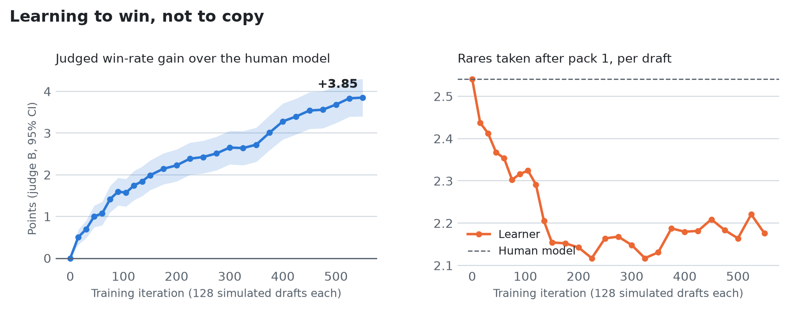
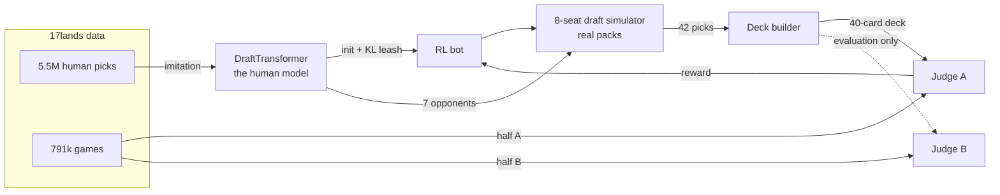
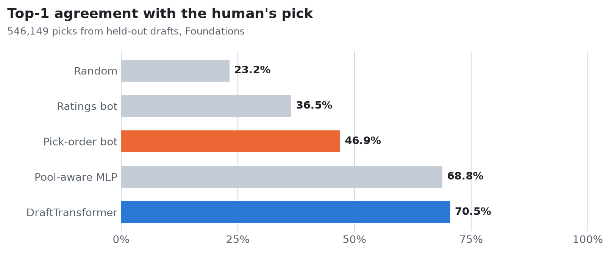
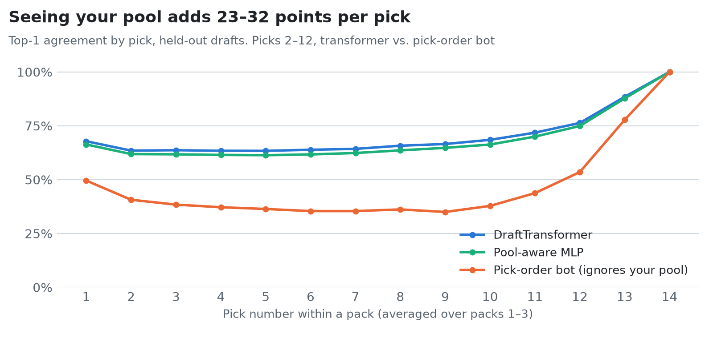
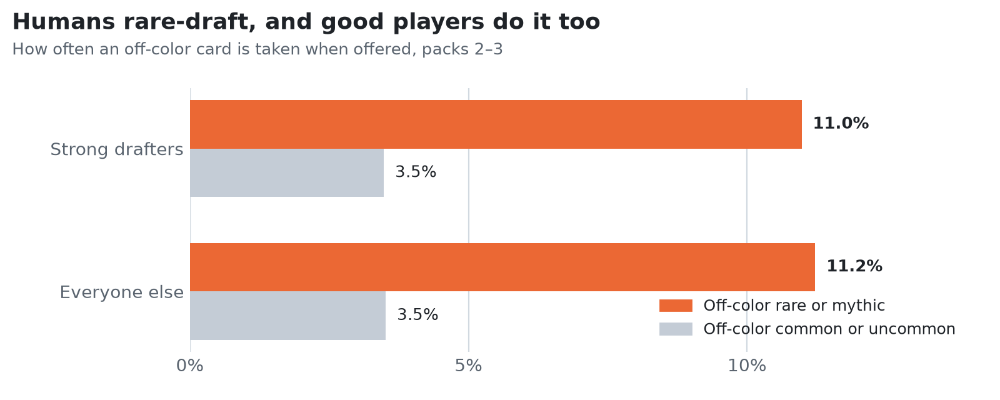
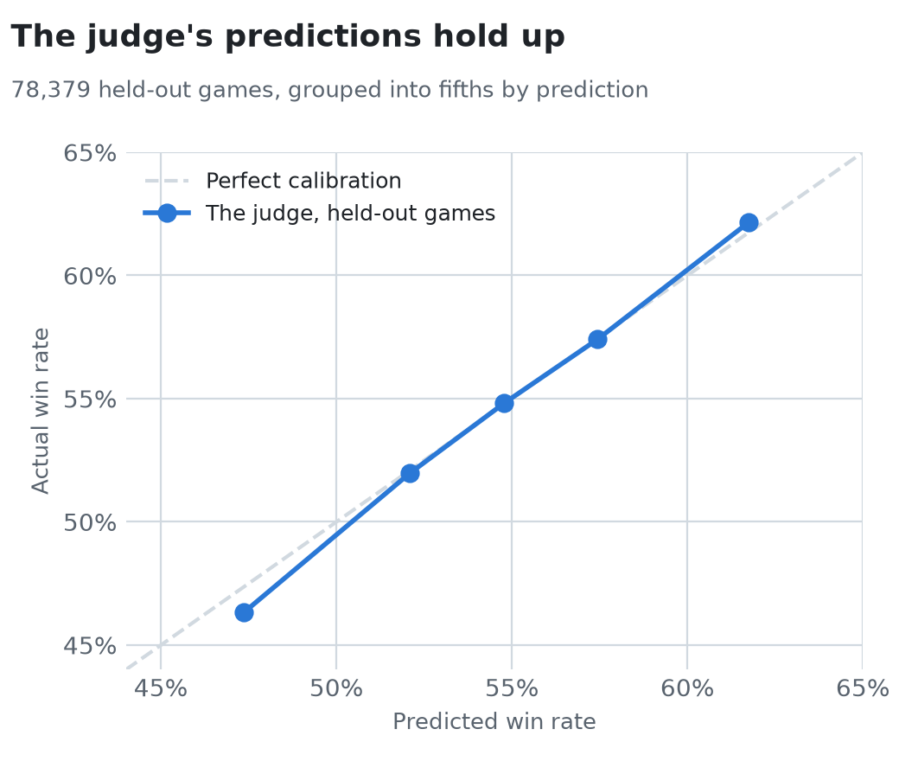
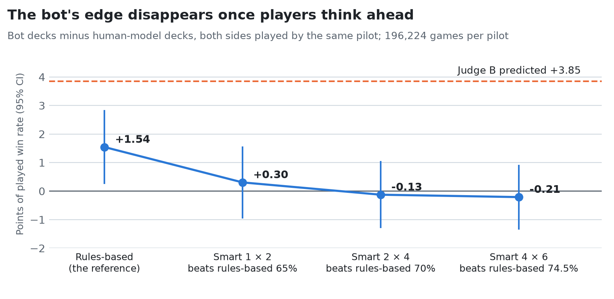
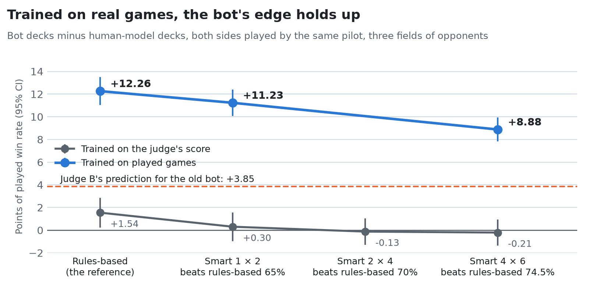
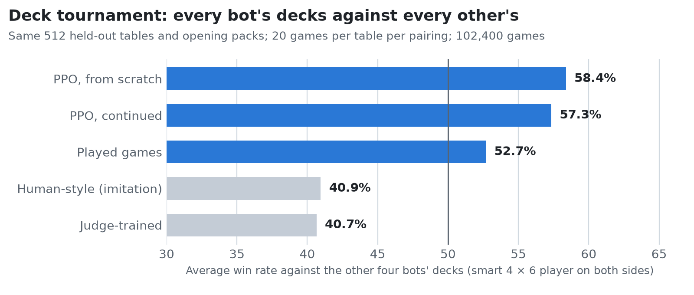

<h1 align="center">Bolt the Bird</h1>

<p align="center">
  <b>An AI that learns to draft Magic: The Gathering from 5.5 million human picks,<br>then teaches itself to draft better than the people it learned from, and to play the decks.</b>
</p>

<p align="center">
  <a href="https://github.com/AdamLiscia/bolt-the-bird/actions/workflows/ci.yml"></a>
  
  
  <a href="LICENSE"></a>
</p>

---

**TL;DR**
- Learns to draft Magic: The Gathering from **5.5 million** real picks; matches the human's pick **70.5%** of the time.
- Retrained on games actually played in a **Rust rules engine** that plays every card in the set: its decks win **62%** of games where human-style decks win 50%.
- A second network taught itself to play by **self-play** (about 790,000 games) and beats the strongest hand-built player **58%** of the time.
- You can play it: a FastAPI service runs drafts and games against Bolt, in testing on Nerd Leagues.

*Prefer plain English? Read the whole story at three reading levels (Easy, Hobbyist, Technical):*
**[adamliscia.com/bolt](https://adamliscia.com/bolt/)**

---

In a Magic draft, eight players open packs, take one card, and pass the rest. Forty-two picks later,
each player builds a deck from what they took. Good drafting means reading the table, committing to
colors, and knowing when the shiny rare isn't worth it.

Bolt the Bird got there in five steps:

1. **Imitate.** A transformer studies 5.5 million real picks from
   [17lands](https://www.17lands.com/public_datasets) and learns to draft like a person. It matches the
   human's actual pick **70.5%** of the time on drafts it has never seen. The best bot that ignores your
   cards so far reaches 46.9%.
2. **Improve.** In a simulated 8-player draft, the bot is rewarded for finished decks that win, not for
   copying. After 70,400 practice drafts, its decks are judged **+3.9 points** better than the human
   model's, by a judge it never trained against. Along the way it unlearned a human habit (taking
   off-color rares for their collection value) and found an open lane: White-Red, one of the set's
   two strongest pairs in real games, yet under 8% of the decks people play.
3. **Play it out.** A Magic rules engine written in Rust plays every card in the set. Played out,
   that judged edge mostly disappears: about **1.5 points** when both sides play by simple rules,
   and **nothing** once both sides use a smart player that thinks a move ahead. Finding that out is
   what the engine was built for.
4. **Learn from real games.** Retrained with played games as the reward instead of the judge, the
   bot's decks win **62.3%** of games against the same human-style opponents that the human
   model's decks beat 49.6% of the time: **+12.7 points**, even when both sides are played by a
   stronger smart player than the one it trained against. Switching the learning method to PPO
   reached the old method's best result in about 8 times fewer training rounds.
5. **Learn to play.** A network that reads the board and scores every legal move learns Magic itself:
   first by copying the smart player, then by playing hundreds of thousands of games against itself and
   other players, rewarded only for winning. It now beats the strongest smart player **57.9%** of the
   time head to head, choosing each move in one quick pass instead of playing every candidate move out.
   With it piloting both sides, the drafting results hold: the PPO bot's edge is the same **+12.6
   points**, and the judge-trained bot's edge, which the smart player had erased, comes back (+4.7).
   You can play it: a small web service runs drafts and games against Bolt.

<picture>
  <source media="(prefers-color-scheme: dark)" srcset="docs/figures/rl-curve-dark.png">
  
</picture>

## Results

| | Result | Measured on |
|---|---|---|
| **Imitation** | 70.5% top-1 agreement with human picks (71.8% for strong drafters) | 546,149 picks from about 13,000 held-out drafts |
| **Finding** | Humans take off-color rares 3.2× as often as off-color commons, and strong drafters do it just as much | Packs 2–3 of 131,183 drafts |
| **Judge** | Predicts deck win rate, calibrated to within about a point | 78,379 held-out games |
| **Learning to win** | +3.85 ± 0.23 points of judged win rate, 14% fewer late rares, 81% human-like | 512 held-out tables, scored by a judge excluded from training |
| **Playing it out** | +1.54 ± 0.66 points of played win rate (rules-based player); −0.21 ± 0.58 (smart player) | The same 1,024 decks in the Rust engine, each against every deck of three separate 64-deck fields |
| **Tournament** | PPO bots' decks beat the judge-trained bot's 63–64% and the human model's 62–64% head to head; judge-trained vs. human model 50.1% | Five bots' decks from the same 512 tables, every pairing, 102,400 games, smart 4 × 6 player |
| **Learning from real games** | +12.67 ± 0.56 points of played win rate with the strongest smart player (62.3% vs. 49.6%); +17.36 ± 0.66 with the rules-based player | PPO; the same tables and fields; the bot trained only against a weaker smart player |
| **Playing Magic** | The learned player beats the smart 4 × 6 player 57.9 ± 1.6% head to head, and the rules-based player 75.9 ± 1.3% (4 × 6 itself: 70.9%) | 1,000 games per matchup on 500 pairs of held-out decks, sides swapped |
| **Re-graded by the learned player** | PPO bot's edge +12.57 ± 0.58 (unchanged); the judge-trained bot's edge, zero with the smart player, is +4.6 to +4.8 on each field (± about 0.6) | The same tables and all three fields, the learned player on both sides |

Every number comes from a file in [`results/`](results/), and every chart is generated from those files
by [`scripts/make_figures.py`](scripts/make_figures.py).

## How it works



- **The human model** is a transformer over a *set* of cards: one token per card in the pool and the
  pack, plus a draft-position token. Attention lets each pack card weigh itself against what you've
  taken and what you'd be passing.
- **The judge** predicts a deck's game win rate. Player skill is a separate input, held fixed when
  decks are scored. Without it, the judge would credit a strong player's deck for the player's skill.
- **The deck builder** tries all ten color pairs and greedily adds whichever spell raises the
  judged win rate most, with on-color dual lands and 16 or 17 lands.
- **The RL loop** (REINFORCE) rewards picks from drafts whose decks the judge rates highly. A KL
  penalty keeps the bot close to human drafting.
- **Two judges on disjoint halves of the games** keep the result honest. The bot trains against
  judge A and is graded only by judge B. A bot that learned to fool A gets no credit from B.

## Try it

```bash
git clone https://github.com/AdamLiscia/bolt-the-bird && cd bolt-the-bird
make install        # .venv + the package
python scripts/demo.py --seed 7
```

The demo needs no data download. Packs come from [`assets/`](assets/) (real opening packs from
held-out drafts), and the trained models download from the
[release](https://github.com/AdamLiscia/bolt-the-bird/releases) on first run.

```text
Bolt the Bird drafts seat 1 of 8. The other 7 seats draft like people. Table #7

Pack 1
  p1  R Chandra, Flameshaper                99%
  p2  G Scavenging Ooze                     86%
  p3  G Gnarlid Colony                      67%
  p4  G Ambush Wolf                         51%   a person would likely take Reclamation Sage
  p5  G Bite Down                           99%
  ...
The deck  RG 16 lands
  1x R Abrade
  2x G Apothecary Stomper
  1x G Beast-Kin Ranger
  ...
Judge B (never seen by the bot during training), average pilot:
  Bolt the Bird's deck     62.6%
  the next seat's deck     57.2%
```

### Play against it

The learned player and the drafters run as a small local web service ([`docs/api.md`](docs/api.md)):
draft against Bolt (one call per pick, or every bot seat at once), get a bot-drafted deck, and play a
game against Bolt, or two people against each other with the engine keeping the rules. The service
returns each seat's view (no hidden information), every legal move with a readable label, the boards
in between your decisions, and a game log.

```bash
BOLT_KEY=<a secret> python -m bolt.service        # http://127.0.0.1:8766; every request sends X-Bolt-Key
python -m practice                                 # draft practice in the browser, http://localhost:8765
```

[Nerd Leagues](https://nerdleagues.com) runs its admin-only "Practice vs Bolt" games and bot drafts on this
API: Easy, Medium and Hard are the rules-based and smart players, Expert is the learned player.

## Reproduce everything

```bash
make install
make test          # 21 tests on synthetic data, about a second
make data          # 17lands FDN picks + games, ~250 MB
make reproduce     # every result and chart, end to end
```

| Step | Command | Time (Apple M4) |
|---|---|---|
| Stream ~7 GB of CSV into 114 MB of arrays, without unpacking | `make prepare` | ~1 min |
| Baselines | `make baselines` | ~1 min |
| MLP + transformer | `make draft-models` | ~4 h |
| Rare-drafting analysis | `make rare-drafting` | ~1 min |
| Judges (full, A, B) | `make judges` | ~3 min |
| Deck builder vs. humans | `make builder` | ~1 min |
| RL | `make rl` | ~2 h (CPU) |
| Charts | `make figures` | seconds |

## The details

### Data and splits

17lands publishes Arena drafts and games from players who run its tracker. The pick data has a row
per pick (the pack, the pool so far, the pick, and the player's rank and win-rate bucket). The game
data has a row per game (the deck, cards drawn, play/draw, and the result).

**Every split is by draft** (a hash of `draft_id`, 85/5/10). If picks were split one by one, pick 4 of
a draft in the test set would reveal most of the pool from pick 3 in training. A test enforces this.

### Drafting like a person

<picture>
  <source media="(prefers-color-scheme: dark)" srcset="docs/figures/scoreboard-dark.png">
  
</picture>

| Bot | How it picks | All | Strong drafters |
|---|---|---|---|
| Random | uniformly | 23.2% | 23.3% |
| Ratings bot | highest games-in-hand win rate (the 17lands stat) | 36.5% | 38.8% |
| Pick-order bot | highest take rate when seen | 46.9% | 48.9% |
| Pool-aware MLP | sums pool embeddings, scores pack cards (145k params) | 68.8% | 70.1% |
| **DraftTransformer** | attention over pool + pack (1.8M params) | **70.5%** | **71.8%** |

The ratings and pick-order bots are computed from training data only. Seeing the pool is where the
gain comes from. Bots that ignore the pool fall toward 35% mid-pack, once the drafter has committed
to colors:

<picture>
  <source media="(prefers-color-scheme: dark)" srcset="docs/figures/by-pick-dark.png">
  
</picture>

### Finding: people rare-draft, and good players do it too

<picture>
  <source media="(prefers-color-scheme: dark)" srcset="docs/figures/rare-drafting-dark.png">
  
</picture>

For each draft, we take the drafter's two main colors from their final pool and ask how often an
off-color card is taken from pack 2 on ([`scripts/rare_drafting.py`](scripts/rare_drafting.py)).
Off-color rares are taken 3.2× as often as off-color commons and uncommons, and strong drafters do it
just as much as everyone else. On Arena you keep what you draft, so a rare can be worth more to a
collection than to a deck.

Drafts with two or more late off-color rare picks average 2.70 match wins, against 2.94 with none.
That's a correlation, not causation.

The consequence is that filtering to good players can't remove the habit. Fine-tuning on strong
drafters only left accuracy unchanged (71.9% vs. 71.8%). **To draft better than people, the bot has
to optimize for winning, not for agreement.**

### The judge, the builder, the simulator

<picture>
  <source media="(prefers-color-scheme: dark)" srcset="docs/figures/judge-calibration-dark.png">
  
</picture>

| Judge (78,379 held-out games) | Log loss | AUC |
|---|---|---|
| Skill and play/draw only | 0.6772 | 0.584 |
| + one weight per card | 0.6745 | 0.596 |
| + card interactions (embedding sum + MLP) | **0.6734** | **0.598** |

A single game of Magic is mostly variance, so AUC moves little. Calibration is what matters for a
reward, and it holds to within about a point. The cards the linear judge values most (Embercleave;
Liliana, Dreadhorde General; Curator of Destinies) are the set's known bombs.

**The deck builder** was checked against 966 real players' own pools. It keeps 79% of their spells
and matches their deck shape: 14.8 vs. 15.3 creatures, 16.6 vs. 16.7 lands.

**The simulator** seats 8 drafters with real opening packs, 3 packs of 14, passing left-right-left.
Tests verify that every seat ends with 42 cards and that no card is created or lost.

### Learning to win

| Iteration | Bot (judge B) | Human model | Gain | Rares after pack 1 | Agreement with the human model |
|---|---|---|---|---|---|
| 0 | 60.02% | 60.02% | 0.00 | 2.54 | 100% |
| 45 | 61.03% | 60.02% | +1.00 ± 0.13 | 2.37 | 95.9% |
| 90 | 61.62% | 60.02% | +1.60 ± 0.17 | 2.32 | 93.3% |
| 150 | 62.01% | 60.02% | +1.99 ± 0.18 | 2.15 | 90.3% |
| 250 | 62.45% | 60.02% | +2.43 ± 0.20 | 2.16 | 88.3% |
| 350 | 62.75% | 60.02% | +2.72 ± 0.21 | 2.13 | 86.0% |
| 450 | 63.56% | 60.02% | +3.54 ± 0.22 | 2.21 | 84.6% |
| 550 | **63.87%** | 60.02% | **+3.85 ± 0.23** | **2.18** | 81.2% |

Each evaluation drafts 512 held-out tables twice: once with the bot in seat 0 and once with the human
model, using the same packs and the same random seed. Judge B builds and scores both decks. Training
ran 550 iterations (70,400 drafts, about 7 hours on a laptop CPU) and stopped there on purpose: the last
25 iterations added 0.02 points, and agreement with the human model had fallen to the 80% line set
in advance as the limit for drift.

**What it learned.** Over training, judge A's reward rose 3.2 points and judge B's verdict rose
1.9. Most of the gain carries over to the judge the bot never saw, and the gap is the expected cost of
optimizing against one model. The bot's decks keep a normal shape (14.6 creatures, 16 or 17 lands),
but it now drafts White-Red at 45% of tables, against 19% for the iteration-150 bot. That is a real
edge, not a judge exploit. In 17lands games, White-Red decks win 2.1 points more than their pilots'
skill predicts, second only to Red-Green, yet they make up under 8% of games. Against seven human-like
drafters, the lane is usually open. Source: [`scripts/archetypes.py`](scripts/archetypes.py).

### Playing it out

A judge is a model, and a model can be fooled. So the decks were played out in a rules engine
written for this project ([`engine/`](engine/), Rust with Python bindings). It implements all 286
Foundations cards, each with a test written from its rules text (376 tests in all), and plays about
300 games a second with the rules-based pilot.

The same 512 tables were drafted by the bot and by the human model, and every deck played every
deck of three separate fields of 64 human-model decks, once each, with the same seeds for the bot's
deck and the human model's. Two pilots played both sides: a rules-based player (curve out, attack
when it's safe, block to survive), and a smart player that plays each candidate move out in
games where the hidden cards are guessed again, then keeps the best. The smart player beats the
rules-based one 74.5% of the time.

| | Bot decks | Human-model decks | Gap |
|---|---|---|---|
| Judge B (predicted) | 63.87% | 60.02% | **+3.85 ± 0.23** |
| Played, rules-based player (196,224 games) | 50.92% | 49.38% | **+1.54 ± 0.66** |
| Played, smart player (196,224 games) | 49.43% | 49.64% | **−0.21 ± 0.58** |

With simple pilots the bot's decks win more, on each of the three fields (+1.45, +1.53, +1.64).
Give both sides a player that looks ahead and the edge disappears (−0.16, −0.09, −0.37): the drop
is −1.75 ± 0.38, more than four standard errors, so it isn't noise. With the smart player, whatever the
bot learned to value pays off against simple play and gets neutralized by better play; with the learned
player (below, "Re-grading"), it pays off again. Either way, the judge
overstated it, and its per-deck scores track played results only loosely (correlation 0.12–0.15).
The likeliest reason is a shared blind spot: both judges learned from human-built decks and rate
some deck traits more highly than play does, and the bot found them. Two judges on separate data
can't catch a blind spot they share; playing the games can. An earlier rules-based run against one
field (258,048 games) gave +1.59 ± 0.64. Details:
[`docs/engine/VALIDATION.md`](docs/engine/VALIDATION.md).

**Where the edge goes.** Two weaker smart players fill in the gap between the two: one that plays
out only 2 moves, once each, and one that plays out 4 moves twice each. They beat the rules-based
pilot 65% and 70% of the time; the full smart player beats it 74.5%. Each played the same three
round-robins.

<picture>
  <source media="(prefers-color-scheme: dark)" srcset="docs/figures/pilot-ladder-dark.png">
  
</picture>

It's a cliff, not a slope. The weakest smart player already takes away 1.24 ± 0.26 of the 1.54 points;
by the 2 × 4 pilot it's all gone. (The bars are wide because they include how much the 512 deck
pairs differ; each drop is measured on the same decks and games, so it's much tighter.) The bot
learned to build decks that beat a player who never looks ahead. To learn decks that beat
players who do, it needs a reward from games played by players who do.

### Learning from real games

So the judge came out of the reward. In the same training loop, each practice draft's finished deck
now plays its 7 tablemates' decks, twice each, in the engine, with the weakest smart player (1 × 2)
on both sides. Its win rate is the reward. Everything else is unchanged: 128 tables per
iteration, the same leash to the human model. A check first ([`scripts/played_reward_check.py`](scripts/played_reward_check.py)):
two independent sets of those games agree on which decks are better (split-half correlation
0.56), so the reward is noisy but learnable. Judge A, by contrast, barely predicts them (0.11).

Training ([`scripts/train_rl.py`](scripts/train_rl.py) `--reward played`) ran 250 iterations,
about 450,000 games. The finished bot then drafted the same 512 held-out tables and played the
same three round-robins as before, the human model's decks playing the identical games:

<picture>
  <source media="(prefers-color-scheme: dark)" srcset="docs/figures/played-reward-dark.png">
  
</picture>

| Pilot on both sides | Played-reward bot | Human model | Gap | Judge-trained bot's gap |
|---|---|---|---|---|
| Rules-based | 61.6% | 49.4% | **+12.26 ± 0.63** | +1.54 |
| Smart 1 × 2 (trained against) | 60.7% | 49.4% | **+11.23 ± 0.59** | +0.30 |
| Smart 4 × 6 (never trained against) | 58.5% | 49.6% | **+8.88 ± 0.54** | −0.21 |

Every field agrees: +8.88, +8.82 and +8.94 with the 4 × 6 player. The edge holds with the
rules-based pilot, which the bot never trained with, and with the stronger smart player, which it
never saw. It shrinks from about 12 points to about 9 as play improves, so part of what it learned
pays off most against weaker play. Judge B rates the same change at only +0.9 points: the bot
learned things the judge can't see.

Training longer helped against every pilot. Halfway, at iteration 135, the same evaluation gave
+8.06, +7.81 and +5.91; from 135 to 250 the edge with the 4 × 6 player it never trained against grew
by 3.0 points, about as much as with the 1 × 2 player it did train against (+3.4), so the extra
training made better decks, not just decks tuned to its training pilot. (The 2 × 4 player wasn't run
for these bots.) Details: [`docs/engine/VALIDATION.md`](docs/engine/VALIDATION.md); numbers in
[`results/engine_pilot_rl_played250.json`](results/engine_pilot_rl_played250.json) and
[`results/engine_pilot_rl_played135.json`](results/engine_pilot_rl_played135.json).

**Then PPO.** The learning method above takes one small step per batch of drafts. PPO takes several
careful steps on the same drafts, clipped so no batch moves a pick too far (`train_rl.py --algo
ppo`). Continued from the round-250 bot, it pushed past where the old method had levelled off. Its
iteration-345 bot, through the same evaluation:

| Pilot on both sides | PPO bot | Human model | Gap | Round-250 bot's gap |
|---|---|---|---|---|
| Rules-based | 66.7% | 49.4% | **+17.36 ± 0.66** | +12.26 |
| Smart 1 × 2 (trained against) | 65.4% | 49.4% | **+16.00 ± 0.62** | +11.23 |
| Smart 4 × 6 (never trained against) | 62.3% | 49.6% | **+12.67 ± 0.56** | +8.88 |

Started from scratch instead, PPO reached the old method's best result in 30 iterations instead of
250. It also over-optimizes: it peaked around iteration 120 and then got worse as it drifted further
from human drafting, so it needs early stopping or a firmer leash. Details:
[`docs/engine/VALIDATION.md`](docs/engine/VALIDATION.md) ("PPO");
[`results/engine_pilot_rl_ppo345.json`](results/engine_pilot_rl_ppo345.json).

### The tournament

The last test puts the bots straight against each other. Each of five bots drafted the same 512
held-out tables from the same opening packs. Every bot's deck then played every other bot's deck
from the same table, 20 games per table per pairing, with the smart 4 × 6 player on both sides
(102,400 games; [`scripts/engine_tournament.py`](scripts/engine_tournament.py)).

<picture>
  <source media="(prefers-color-scheme: dark)" srcset="docs/figures/tournament-dark.png">
  
</picture>

Head to head (row's win rate against column, ± about 0.7 points):

| | Human-style | Judge-trained | Played games | PPO, continued | PPO, from scratch |
|---|---|---|---|---|---|
| **Human-style** | | 49.9% | 40.6% | 37.5% | 35.7% |
| **Judge-trained** | 50.1% | | 40.1% | 36.9% | 35.5% |
| **Played games** | 59.4% | 59.9% | | 45.8% | 45.7% |
| **PPO, continued** | 62.5% | 63.1% | 54.2% | | 49.7% |
| **PPO, from scratch** | 64.3% | 64.5% | 54.3% | 50.3% | |

Every step of the project beats the one before it, except the judge: its bot ties the human
model's decks head to head (50.1%), exactly what the round-robins said. Rewarding played games is
what made the difference, and PPO added more. The two PPO bots tie each other; the one trained from
scratch got there with about a third of the training. With the rules-based pilot the order is the
same. Numbers in [`results/engine_tournament.json`](results/engine_tournament.json).

### Learning to play

Every result above runs through a pilot, so a better pilot makes every grade more trustworthy. The
smart player is good but slow: before each decision it plays every candidate move out several times.
The last step trains a network to play instead ([`docs/play/`](docs/play/)).

**The network** reads what a player can see: their hand, both battlefields (power, toughness, tapped,
attacking, blocking), graveyards, the stack, life totals and the opponent's hand size. Each legal move
becomes a token that points at the cards it involves; the network scores every move and estimates its
chance of winning. 0.9 million parameters; it makes every decision the engine asks for, from mulligans
to blocks to instant-speed tricks.

**Copying wasn't enough.** Trained on 2.5 million of the smart player's decisions, it picked the same
move 90.6% of the time, yet won only 44.6% against the rules-based player (the smart player wins 60.3%
there). A second round, where the smart player labelled the positions the network's own games reached,
changed nothing: the smart player's edge comes from looking ahead, and a copy of its habits doesn't
have that.

**Self-play did it.** From the copy, the network played a mix of opponents (the rules-based player, the
smart player, its own past versions and itself), learning only from who won, with PPO and a leash to
where it started. Two changes mattered: crediting each move with how much it changed the network's own
estimate of winning (generalized advantage estimation) instead of giving every move of a ~100-move game
the same final result, and 640 games per update instead of 320. Without them, self-play stalled near
55% and drifted down once its leash loosened, the over-optimization seen in drafting.

| Network | vs. rules-based | vs. smart 1 × 2 | vs. smart 4 × 6 |
|---|---|---|---|
| Copying the smart player | 44.6% | 35.8% | |
| Self-play, end-of-game credit only (best of 270 updates) | 54.8% | 47.4% | |
| Self-play, per-move credit, update 260 | 67.6% | 60.7% | 47.1% |
| Self-play, per-move credit, update 850 | 71.1% | 65.4% | 55.0% |
| Seeing the spell it targets for, 170 more updates | **75.9%** | **68.0%** | **57.9%** |
| *Smart 4 × 6, for comparison* | *70.9%* | | |

Each number is 1,000 games (± about 1.5 points) on 500 pairs of decks it never trained on, each side
played once, the network taking its top move. Against the rules-based player it now does better than
smart 4 × 6 (75.9% vs. 70.9%); head to head it wins 57.9%, about five standard errors above even, while
choosing each move in one pass of the network. Training ran on a laptop CPU: about 790,000 self-play
games across four runs. Numbers: [`results/play_eval_ppo4_best*.json`](results/),
[`results/play_eval_ppo3e_best*.json`](results/); log: [`docs/play/LOG.md`](docs/play/LOG.md).

**A blind spot a person found.** The first time someone played it through the
[service](#play-against-it), it cast Giant Growth on *their* creature. Measured: when a pump spell or
aura could go on either side, the update-850 network chose the opponent's creature 65% of the time
(47 of 72), while the built-in players never did. The cause was the input, not the training: while a
spell's targets are chosen, the engine hadn't put the spell on the stack yet, so the network couldn't
see whether it was targeting with Giant Growth or with removal. It had learned "target their
creatures," which is right for removal 96% of the time. The engine now shows the spell being cast, the
network reads it, and 170 more updates of self-play from update 850 gave the stronger player in the
table above. That fixed the input but not yet the habit: pumps still go to the opponent's side 47% of
the time (34 of 73), so the service has the smart player choose the learned player's targets until a
targeted fix lands. [`scripts/target_check.py`](scripts/target_check.py) measures it.

### Re-grading the drafters with the learned player

The drafting results were all played by the engine's built-in players. With the learned player
piloting both sides of the same games (the update-850 player; the re-grade ran before the targeting
fix):

| Bot (average win rate against the other four bots' decks) | Smart 4 × 6 | Learned player |
|---|---|---|
| PPO from scratch | 58.4% | 55.9% |
| PPO, continued | 57.3% | 55.5% |
| Played games | 52.7% | 53.0% |
| Trained on the judge | 40.7% | **46.5%** |
| Human-style (imitation) | 40.9% | 39.1% |

The order of the trained bots holds and the gaps narrow a little. Against the three human-model fields,
the PPO bot's edge over the human model's decks is **+12.57 ± 0.58** points with the learned player
(fields a/b/c +12.64 / +12.56 / +12.51), the same as with smart 4 × 6 (+12.67). The one change is the
judge-trained bot: its edge, which the smart player erased (−0.16 / −0.09 / −0.37), is **+4.67 / +4.64 /
+4.82** (each ± about 0.6) with the learned player, and the tournament agrees (it beats the human
model's decks 56.2% head to head). So "neutralized by better play" was a property of the smart
player, not of better play in general: what the judge taught the bot pays off once both sides play
well enough. It is still far behind training on played games. Numbers:
[`results/engine_tournament.json`](results/engine_tournament.json),
[`results/engine_pilot_validation.json`](results/engine_pilot_validation.json),
[`results/engine_pilot_rl_ppo345.json`](results/engine_pilot_rl_ppo345.json).

### Design decisions

| Decision | Why |
|---|---|
| Split by draft, not by pick | Picks within a draft share a pool, so splitting by pick leaks |
| No positional encoding over the pool | A pool is a set. A test checks the model ignores pool order |
| Skill as a judge input, fixed at scoring time | Separates deck quality from pilot quality |
| Two judges on disjoint games | Catches reward hacking against the training judge |
| KL leash to the human model | Improve on human drafting without drifting into decks no human would build |
| Same packs and seed for bot and baseline | Paired comparison: the standard error is on the difference, which shrinks it |
| Stream gzip, never unpack | ~7 GB of CSV becomes 114 MB of arrays on a laptop with 35 GB free |

**One bug worth telling.** The first KL penalty used `torch.where` to zero out cards not in the pack.
`-inf - -inf` is NaN, and `torch.where` hides that in the forward pass but not in the gradient. On
Apple's GPU, the NaN-poisoned model hung the machine. The fix masks before the arithmetic.
`tests/test_rl.py` keeps it fixed, and the old code fails that test.

## Limitations

- **The judged edge doesn't hold up in play.** Judge B says +3.85; played games show +1.5 with
  simple pilots and about zero with a stronger one. Both judges learned from human-built decks,
  so they share blind spots, and the bot found some. Rewarding played games instead fixed it.
- **The played-reward bot is one run, against one weak pilot.** Its edge shrinks as the pilot gets
  stronger. Long runs three times hit a rare memory corruption that safe Rust shouldn't allow, cause
  not found ([`docs/engine/QUESTIONS.md`](docs/engine/QUESTIONS.md)); training now plays its games
  in a worker process that is restarted if it dies, and stored results replay identically.
- **The pilots are not experts.** The engine's built-in players play far below a strong human, and so,
  most likely, does the learned player: it beats the strongest built-in player 57.9%, still aims pump
  spells at the opponent's creatures about half the time (above), and hasn't been measured against
  people. About 1.2% of its re-grading games hit the move limit (counted as draws, as everywhere here)
  against almost none for the built-in players. Decks that reward skilled play can look worse here than they are;
  the judge-trained bot's re-graded edge is an example.
- **The opponents are simulated.** The other 7 seats are the human model, not real people. The
  White-Red lean pays off because human-like drafters leave it open. A table of eight copies of the
  bot would fight over it.
- **One set.** Card IDs are Foundations-specific. A new set needs its own 17lands data and a retrain.
- More in the [model card](docs/MODEL_CARD.md).

## Roadmap

- [x] Imitation: draft like a person
- [x] Judge, deck builder, draft simulator
- [x] RL against a held-out-validated judge
- [x] Longer RL runs, to the point of diminishing returns
- [x] A rules engine in Rust (PyO3 bindings) that plays the decks out: all 286 cards, played win
      rates alongside the judged ones
- [x] RL rewarded by played games instead of a judge
- [x] A gameplay agent trained by self-play: beats the strongest built-in player head to head
- [x] Re-grade the drafting bots with it
- [ ] Draft practice against the bot on [Nerd Leagues](https://nerdleagues.com): games and drafts
      against Bolt are in an admin-only test there
- [ ] Teach the learned player where pump spells go (until then the smart player picks its targets)

## Repository layout

```text
src/bolt/          the library
  data.py            loading and the draft-level splits
  models.py          PoolMLP, DraftTransformer
  judge.py           DeckJudge
  deckbuild.py       judge-guided deck builder
  sim.py             8-seat draft simulator
  rl.py              the KL penalty
  cards.py           colors, rarity, castability, dual lands
engine/            the Rust rules engine: bolt-core (rules, pilots), bolt-cards (the set), bolt-py
scripts/           one script per result (see the Makefile)
tests/             21 tests on synthetic data
results/           every number in this README
assets/            card metadata and 3,000 real sample packs
docs/              model card and figures
```

## Acknowledgments

- Data: [17lands](https://www.17lands.com/public_datasets) public datasets (CC BY 4.0).
- Card data and land colors: [Scryfall](https://scryfall.com).

Code under the [MIT license](LICENSE). To cite this project, see [CITATION.cff](CITATION.cff).

<sub>Bolt the Bird is unofficial Fan Content permitted under the Fan Content Policy. Not
approved/endorsed by Wizards. Portions of the materials used are property of Wizards of the Coast.
©Wizards of the Coast LLC.</sub>
