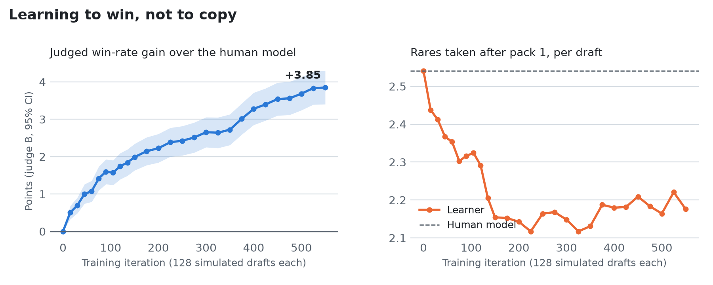
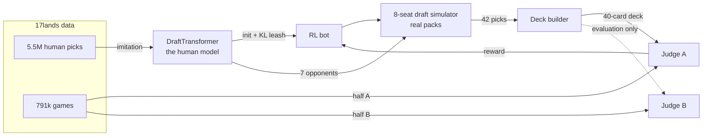
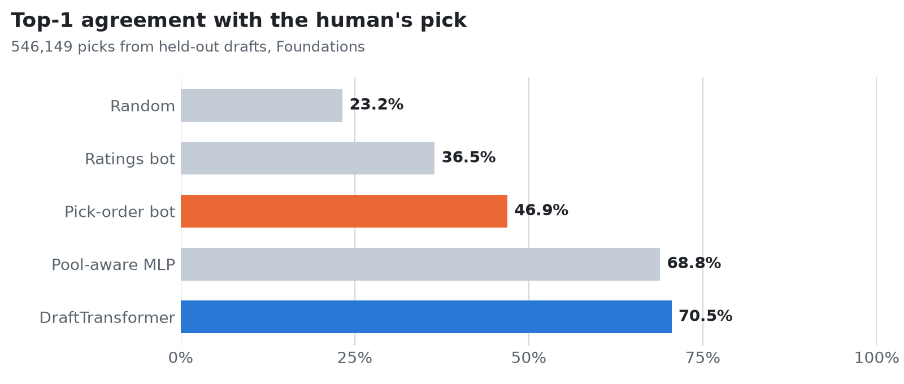
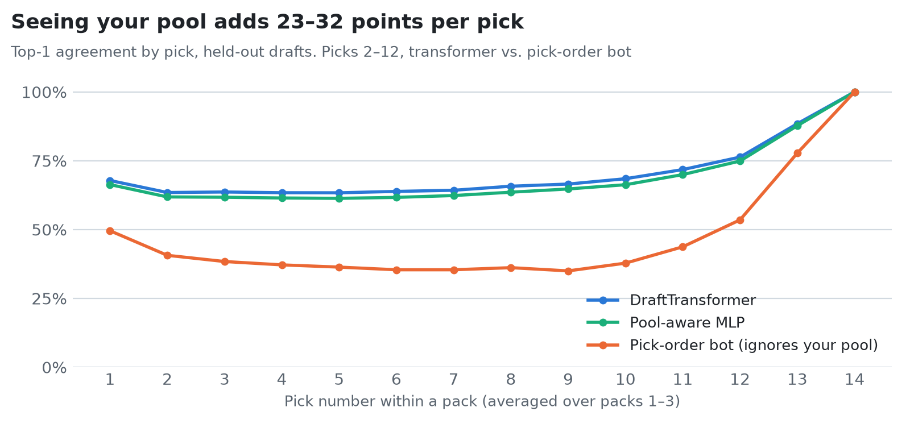
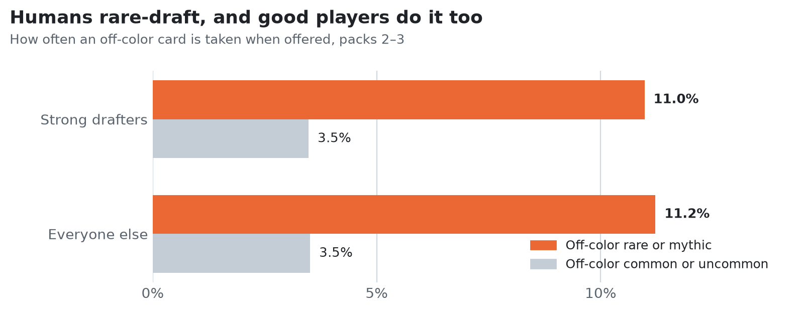
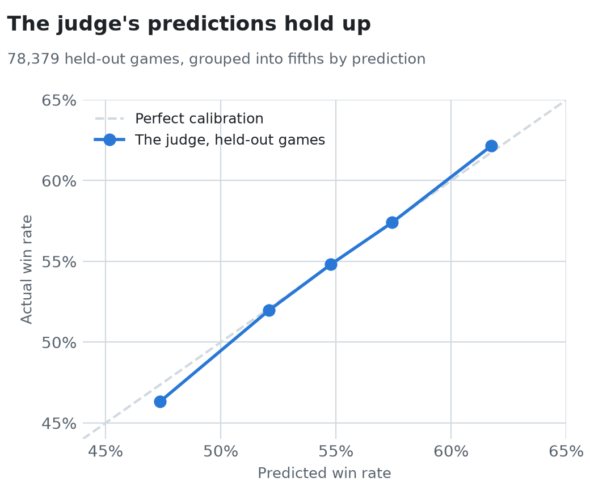

<h1 align="center">Bolt the Bird</h1>

<p align="center">
  <b>An AI that learns to draft Magic: The Gathering from 5.5 million human picks,<br>then teaches itself to draft better than the people it learned from.</b>
</p>

<p align="center">
  <a href="https://github.com/AdamLiscia/bolt-the-bird/actions/workflows/ci.yml"></a>
  
  
  <a href="LICENSE"></a>
</p>

---

In a Magic draft, eight players open packs, take one card, and pass the rest. Forty-two picks later,
each player builds a deck from what they took. Good drafting means reading the table, committing to
colors, and knowing when the shiny rare isn't worth it.

Bolt the Bird learns this in two stages:

1. **Imitate.** A transformer studies 5.5 million real picks from
   [17lands](https://www.17lands.com/public_datasets) and learns to draft like a person. It matches the
   human's actual pick **70.5%** of the time on drafts it has never seen. The best bot that ignores your
   cards so far reaches 46.9%.
2. **Improve.** In a simulated 8-player draft, the bot is rewarded for finished decks that win, not for
   copying. After 70,400 practice drafts, its decks are judged **+3.9 points** better than the human
   model's, by a judge it never trained against. Along the way it unlearned a human habit (taking
   off-color rares for their collection value) and found an open lane: White-Red, one of the set's
   two strongest pairs in real games, yet under 8% of the decks people play.
3. **Play it out.** A Magic rules engine written in Rust plays every card in the set. Over 670,000
   played games, the bot's decks win about **1.5 points** more often when both sides play by simple
   rules, and **nothing** more once both sides use a stronger search player. The judge's +3.9 doesn't
   survive being played, and finding that out is what the engine was built for.

<picture>
  <source media="(prefers-color-scheme: dark)" srcset="docs/figures/rl-curve-dark.png">
  
</picture>

## Results

| | Result | Measured on |
|---|---|---|
| **Imitation** | 70.5% top-1 agreement with human picks (71.8% for strong drafters) | 546,149 picks from about 13,000 held-out drafts |
| **Finding** | Humans take off-color rares 3.2× as often as off-color commons, and strong drafters do it just as much | Packs 2–3 of 131,183 drafts |
| **Judge** | Predicts deck win rate, calibrated to within about a point | 78,379 held-out games |
| **Learning to win** | +3.85 ± 0.23 points of judged win rate, 14% fewer late rares, 81% human-like | 512 held-out tables, scored by a judge excluded from training |
| **Playing it out** | +1.54 ± 0.66 points of played win rate (rules-based pilot); −0.21 ± 0.58 (search pilot) | The same 1,024 decks in the Rust engine, each against every deck of three separate 64-deck fields |

Every number comes from a file in [`results/`](results/), and every chart is generated from those files
by [`scripts/make_figures.py`](scripts/make_figures.py).

## How it works



- **The human model** is a transformer over a *set* of cards: one token per card in the pool and the
  pack, plus a draft-position token. Attention lets each pack card weigh itself against what you've
  taken and what you'd be passing.
- **The judge** predicts a deck's game win rate. Player skill is a separate input, held fixed when
  decks are scored. Without it, the judge would credit a strong player's deck for the player's skill.
- **The deck builder** tries all ten color pairs and greedily adds whichever spell raises the
  judged win rate most, with on-color dual lands and 16 or 17 lands.
- **The RL loop** (REINFORCE) rewards picks from drafts whose decks the judge rates highly. A KL
  penalty keeps the bot close to human drafting.
- **Two judges on disjoint halves of the games** keep the result honest. The bot trains against
  judge A and is graded only by judge B. A bot that learned to fool A gets no credit from B.

## Try it

```bash
git clone https://github.com/AdamLiscia/bolt-the-bird && cd bolt-the-bird
make install        # .venv + the package
python scripts/demo.py --seed 7
```

The demo needs no data download. Packs come from [`assets/`](assets/) (real opening packs from
held-out drafts), and the trained models download from the
[release](https://github.com/AdamLiscia/bolt-the-bird/releases) on first run.

```text
Bolt the Bird drafts seat 1 of 8. The other 7 seats draft like people. Table #7

Pack 1
  p1  R Chandra, Flameshaper                99%
  p2  G Scavenging Ooze                     86%
  p3  G Gnarlid Colony                      67%
  p4  G Ambush Wolf                         51%   a person would likely take Reclamation Sage
  p5  G Bite Down                           99%
  ...
The deck  RG 16 lands
  1x R Abrade
  2x G Apothecary Stomper
  1x G Beast-Kin Ranger
  ...
Judge B (never seen by the bot during training), average pilot:
  Bolt the Bird's deck     62.6%
  the next seat's deck     57.2%
```

## Reproduce everything

```bash
make install
make test          # 21 tests on synthetic data, about a second
make data          # 17lands FDN picks + games, ~250 MB
make reproduce     # every result and chart, end to end
```

| Step | Command | Time (Apple M4) |
|---|---|---|
| Stream ~7 GB of CSV into 114 MB of arrays, without unpacking | `make prepare` | ~1 min |
| Baselines | `make baselines` | ~1 min |
| MLP + transformer | `make draft-models` | ~4 h |
| Rare-drafting analysis | `make rare-drafting` | ~1 min |
| Judges (full, A, B) | `make judges` | ~3 min |
| Deck builder vs. humans | `make builder` | ~1 min |
| RL | `make rl` | ~2 h (CPU) |
| Charts | `make figures` | seconds |

## The details

### Data and splits

17lands publishes Arena drafts and games from players who run its tracker. The pick data has a row
per pick (the pack, the pool so far, the pick, and the player's rank and win-rate bucket). The game
data has a row per game (the deck, cards drawn, play/draw, and the result).

**Every split is by draft** (a hash of `draft_id`, 85/5/10). If picks were split one by one, pick 4 of
a draft in the test set would reveal most of the pool from pick 3 in training. A test enforces this.

### Drafting like a person

<picture>
  <source media="(prefers-color-scheme: dark)" srcset="docs/figures/scoreboard-dark.png">
  
</picture>

| Bot | How it picks | All | Strong drafters |
|---|---|---|---|
| Random | uniformly | 23.2% | 23.3% |
| Ratings bot | highest games-in-hand win rate (the 17lands stat) | 36.5% | 38.8% |
| Pick-order bot | highest take rate when seen | 46.9% | 48.9% |
| Pool-aware MLP | sums pool embeddings, scores pack cards (145k params) | 68.8% | 70.1% |
| **DraftTransformer** | attention over pool + pack (1.8M params) | **70.5%** | **71.8%** |

The ratings and pick-order bots are computed from training data only. Seeing the pool is where the
gain comes from. Bots that ignore the pool fall toward 35% mid-pack, once the drafter has committed
to colors:

<picture>
  <source media="(prefers-color-scheme: dark)" srcset="docs/figures/by-pick-dark.png">
  
</picture>

### Finding: people rare-draft, and good players do it too

<picture>
  <source media="(prefers-color-scheme: dark)" srcset="docs/figures/rare-drafting-dark.png">
  
</picture>

For each draft, we take the drafter's two main colors from their final pool and ask how often an
off-color card is taken from pack 2 on ([`scripts/rare_drafting.py`](scripts/rare_drafting.py)).
Off-color rares are taken 3.2× as often as off-color commons and uncommons, and strong drafters do it
just as much as everyone else. On Arena you keep what you draft, so a rare can be worth more to a
collection than to a deck.

Drafts with two or more late off-color rare picks average 2.70 match wins, against 2.94 with none.
That's a correlation, not causation.

The consequence is that filtering to good players can't remove the habit. Fine-tuning on strong
drafters only left accuracy unchanged (71.9% vs. 71.8%). **To draft better than people, the bot has
to optimize for winning, not for agreement.**

### The judge, the builder, the simulator

<picture>
  <source media="(prefers-color-scheme: dark)" srcset="docs/figures/judge-calibration-dark.png">
  
</picture>

| Judge (78,379 held-out games) | Log loss | AUC |
|---|---|---|
| Skill and play/draw only | 0.6772 | 0.584 |
| + one weight per card | 0.6745 | 0.596 |
| + card interactions (embedding sum + MLP) | **0.6734** | **0.598** |

A single game of Magic is mostly variance, so AUC moves little. Calibration is what matters for a
reward, and it holds to within about a point. The cards the linear judge values most (Embercleave;
Liliana, Dreadhorde General; Curator of Destinies) are the set's known bombs.

**The deck builder** was checked against 966 real players' own pools. It keeps 79% of their spells
and matches their deck shape: 14.8 vs. 15.3 creatures, 16.6 vs. 16.7 lands.

**The simulator** seats 8 drafters with real opening packs, 3 packs of 14, passing left-right-left.
Tests verify that every seat ends with 42 cards and that no card is created or lost.

### Learning to win

| Iteration | Bot (judge B) | Human model | Gain | Rares after pack 1 | Agreement with the human model |
|---|---|---|---|---|---|
| 0 | 60.02% | 60.02% | 0.00 | 2.54 | 100% |
| 45 | 61.03% | 60.02% | +1.00 ± 0.13 | 2.37 | 95.9% |
| 90 | 61.62% | 60.02% | +1.60 ± 0.17 | 2.32 | 93.3% |
| 150 | 62.01% | 60.02% | +1.99 ± 0.18 | 2.15 | 90.3% |
| 250 | 62.45% | 60.02% | +2.43 ± 0.20 | 2.16 | 88.3% |
| 350 | 62.75% | 60.02% | +2.72 ± 0.21 | 2.13 | 86.0% |
| 450 | 63.56% | 60.02% | +3.54 ± 0.22 | 2.21 | 84.6% |
| 550 | **63.87%** | 60.02% | **+3.85 ± 0.23** | **2.18** | 81.2% |

Each evaluation drafts 512 held-out tables twice: once with the bot in seat 0 and once with the human
model, using the same packs and the same random seed. Judge B builds and scores both decks. Training
ran 550 iterations (70,400 drafts, about 7 hours on a laptop CPU) and stopped there on purpose: the last
25 iterations added 0.02 points, and agreement with the human model had fallen to the 80% line set
in advance as the limit for drift.

**What it learned.** Over training, judge A's reward rose 3.2 points and judge B's verdict rose
1.9. Most of the gain carries over to the judge the bot never saw, and the gap is the expected cost of
optimizing against one model. The bot's decks keep a normal shape (14.6 creatures, 16 or 17 lands),
but it now drafts White-Red at 45% of tables, against 19% for the iteration-150 bot. That is a real
edge, not a judge exploit. In 17lands games, White-Red decks win 2.1 points more than their pilots'
skill predicts, second only to Red-Green, yet they make up under 8% of games. Against seven human-like
drafters, the lane is usually open. Source: [`scripts/archetypes.py`](scripts/archetypes.py).

### Playing it out

A judge is a model, and a model can be fooled. So the decks were played out in a rules engine
written for this project ([`engine/`](engine/), Rust with Python bindings). It implements all 286
Foundations cards, each with a test written from its rules text (376 tests in all), and plays about
300 games a second with the rules-based pilot.

The same 512 tables were drafted by the bot and by the human model, and every deck played every
deck of three separate fields of 64 human-model decks, once each, with the same seeds for the bot's
deck and the human model's. Two pilots played both sides: a rules-based player (curve out, attack
when it's safe, block to survive), and a search player that plays each candidate move out in
games where the hidden cards are guessed again, then keeps the best. The search player beats the
rules-based one 72.5% of the time.

| | Bot decks | Human-model decks | Gap |
|---|---|---|---|
| Judge B (predicted) | 63.87% | 60.02% | **+3.85 ± 0.23** |
| Played, rules-based pilot (196,224 games) | 50.92% | 49.38% | **+1.54 ± 0.66** |
| Played, search pilot (196,224 games) | 49.43% | 49.64% | **−0.21 ± 0.58** |

With simple pilots the bot's decks win more, on each of the three fields (+1.45, +1.53, +1.64).
Give both sides a player that looks ahead and the edge disappears (−0.16, −0.09, −0.37): the drop
is −1.75 ± 0.38, more than four standard errors, so it isn't noise. Whatever the bot learned to
value pays off against simple play and gets neutralized by better play. Either way, the judge
overstated it, and its per-deck scores track played results only loosely (correlation 0.12–0.15).
The likeliest reason is a shared blind spot: both judges learned from human-built decks and rate
some deck traits more highly than play does, and the bot found them. Two judges on separate data
can't catch a blind spot they share; playing the games can. An earlier rules-based run against one
field (258,048 games) gave +1.59 ± 0.64. Details:
[`docs/engine/VALIDATION.md`](docs/engine/VALIDATION.md).

### Design decisions

| Decision | Why |
|---|---|
| Split by draft, not by pick | Picks within a draft share a pool, so splitting by pick leaks |
| No positional encoding over the pool | A pool is a set. A test checks the model ignores pool order |
| Skill as a judge input, fixed at scoring time | Separates deck quality from pilot quality |
| Two judges on disjoint games | Catches reward hacking against the training judge |
| KL leash to the human model | Improve on human drafting without drifting into decks no human would build |
| Same packs and seed for bot and baseline | Paired comparison: the standard error is on the difference, which shrinks it |
| Stream gzip, never unpack | ~7 GB of CSV becomes 114 MB of arrays on a laptop with 35 GB free |

**One bug worth telling.** The first KL penalty used `torch.where` to zero out cards not in the pack.
`-inf - -inf` is NaN, and `torch.where` hides that in the forward pass but not in the gradient. On
Apple's GPU, the NaN-poisoned model hung the machine. The fix masks before the arithmetic.
`tests/test_rl.py` keeps it fixed, and the old code fails that test.

## Limitations

- **The judged edge doesn't hold up in play.** Judge B says +3.85; played games show +1.5 with
  simple pilots and about zero with a stronger one.
  Both judges learned from human-built decks, so they share blind spots, and the bot found some.
  The next step is a reward from played games, not from a judge.
- **The pilots are not experts.** Both engine pilots play far below a strong human: neither one
  plans turns ahead, and both assume the opponent won't respond. Decks that reward skilled play
  can look worse here than they are.
- **The opponents are simulated.** The other 7 seats are the human model, not real people. The
  White-Red lean pays off because human-like drafters leave it open. A table of eight copies of the
  bot would fight over it.
- **One set.** Card IDs are Foundations-specific. A new set needs its own 17lands data and a retrain.
- More in the [model card](docs/MODEL_CARD.md).

## Roadmap

- [x] Imitation: draft like a person
- [x] Judge, deck builder, draft simulator
- [x] RL against a held-out-validated judge
- [x] Longer RL runs, to the point of diminishing returns
- [x] A rules engine in Rust (PyO3 bindings) that plays the decks out: all 286 cards, played win
      rates alongside the judged ones
- [ ] A gameplay agent trained by self-play
- [ ] Draft practice against the bot on [Nerd Leagues](https://nerdleagues.com)

## Repository layout

```text
src/bolt/          the library
  data.py            loading and the draft-level splits
  models.py          PoolMLP, DraftTransformer
  judge.py           DeckJudge
  deckbuild.py       judge-guided deck builder
  sim.py             8-seat draft simulator
  rl.py              the KL penalty
  cards.py           colors, rarity, castability, dual lands
engine/            the Rust rules engine: bolt-core (rules, pilots), bolt-cards (the set), bolt-py
scripts/           one script per result (see the Makefile)
tests/             21 tests on synthetic data
results/           every number in this README
assets/            card metadata and 3,000 real sample packs
docs/              model card and figures
```

## Acknowledgments

- Data: [17lands](https://www.17lands.com/public_datasets) public datasets (CC BY 4.0).
- Card data and land colors: [Scryfall](https://scryfall.com).

Code under the [MIT license](LICENSE). To cite this project, see [CITATION.cff](CITATION.cff).

<sub>Bolt the Bird is unofficial Fan Content permitted under the Fan Content Policy. Not
approved/endorsed by Wizards. Portions of the materials used are property of Wizards of the Coast.
©Wizards of the Coast LLC.</sub>
